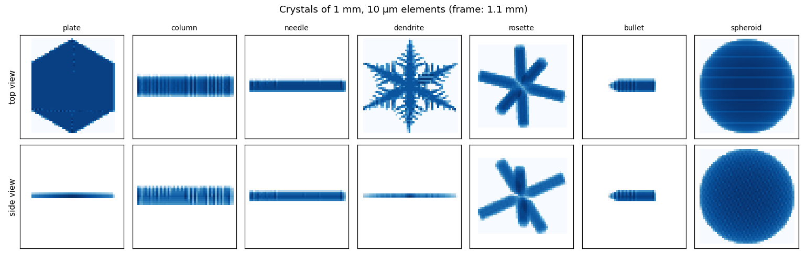
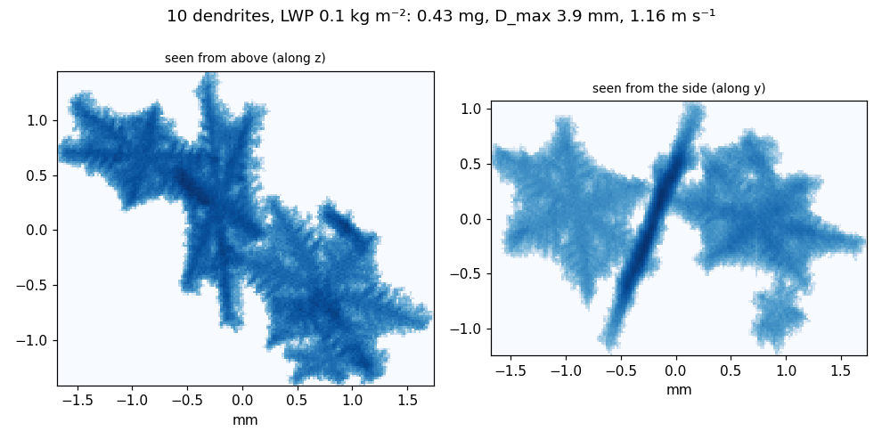
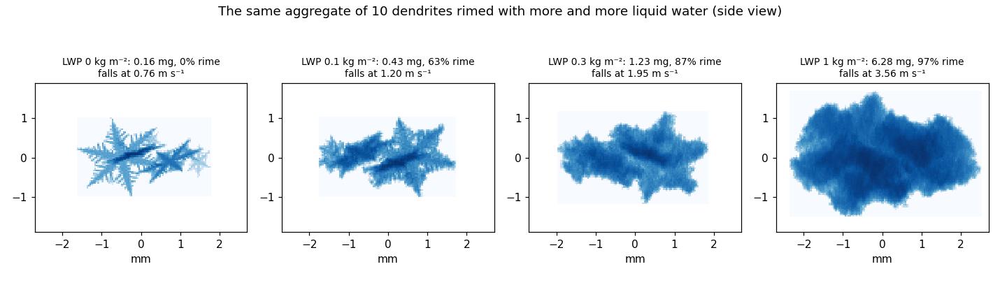
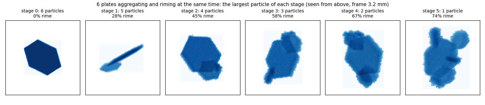
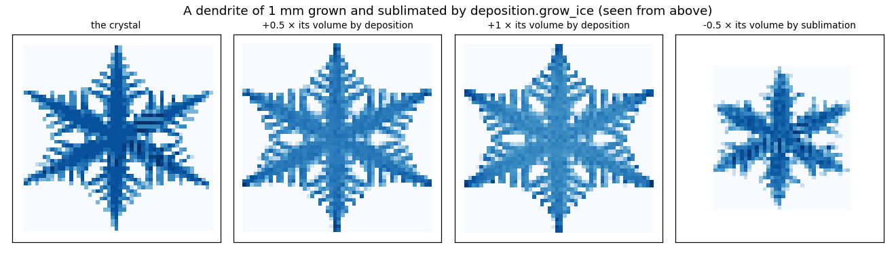
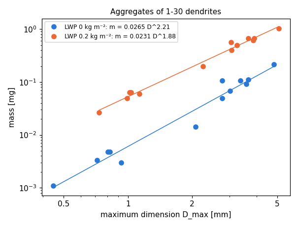

# Examples

[← README](../../README.md) · [User guide](guide.md) · **Examples** · [Technical details](../README.md)

Complete scripts in [`snowagg/examples/`](../examples), each a few seconds to a minute. Run one
with `python examples/<name>.py`: it prints its results, and with a file name as argument it
also draws its figure (`python examples/crystals.py crystals.png`). The [user guide](guide.md)
explains the functions they use. This page is written by `docs/make_examples.py`.

* [The crystal types](#the-crystal-types)
* [A first snowflake](#a-first-snowflake)
* [More and more rime](#more-and-more-rime)
* [Watching a snowflake grow](#watching-a-snowflake-grow)
* [Deposition and sublimation](#deposition-and-sublimation)
* [A mass-size relation](#a-mass-size-relation)
* [Saving a snowflake](#saving-a-snowflake)
* [An ensemble in parallel processes](#an-ensemble-in-parallel-processes)

## The crystal types

The seven crystal types of the model.

A monomer is a crystal shape filled with the points of a cubic grid of volume
elements (here 10 um) and turned into a random orientation. align() turns it
so that its longest axis is along x and its shortest along z: the top view
looks along z, the side view along y.



Run: `python examples/crystals.py crystals.png` (3 s).

<details><summary>The script: <code>examples/crystals.py</code></summary>

```python
"""The seven crystal types of the model.

A monomer is a crystal shape filled with the points of a cubic grid of volume
elements (here 10 um) and turned into a random orientation. align() turns it
so that its longest axis is along x and its shortest along z: the top view
looks along z, the side view along y.

    python crystals.py [crystals.png]

prints the number of elements and the mass of each crystal and, with a file
name, draws them.
"""
import sys

import numpy as np

from snowagg import riming

TYPES = ["plate", "column", "needle", "dendrite", "rosette", "bullet", "spheroid"]
SIZE = 1e-3  # [m]: the diameter, or the length of columns and needles
GRID_RES = 10e-6  # edge of a volume element [m]


def view(ax, X, pixel, along, title=""):
    """Column density of the elements (log scale) seen along axis `along`
    (0: x, 1: y, 2: z), in pixels of `pixel` [m]."""
    h, v = [a for a in (0, 1, 2) if a != along]
    P = np.floor((X[:, [h, v]] - X[:, [h, v]].min(0)) / pixel).astype(int)
    img = np.zeros(P.max(0) + 1)
    np.add.at(img, tuple(P.T), 1)
    x0, y0 = X[:, [h, v]].min(0) * 1e3
    ax.imshow(np.log1p(img.T), origin="lower", cmap="Blues", interpolation="nearest",
              extent=[x0, x0 + img.shape[0] * pixel * 1e3, y0, y0 + img.shape[1] * pixel * 1e3])
    ax.set_title(title, fontsize=9)


def main(png=None):
    crystals = {}
    for kind in TYPES:
        gen = riming.gen_monomer(psd="monodisperse", size=SIZE, mono_type=kind, grid_res=GRID_RES)
        cry = gen()  # an Aggregate made of one crystal
        cry.align()
        mass = riming.rho_i * cry.num_elements * GRID_RES**3
        print(f"{kind:9s} {cry.num_elements:7,} elements, mass {mass * 1e9:6.1f} ug")
        crystals[kind] = cry.X - cry.X.mean(0)
    if png:
        import matplotlib
        matplotlib.use("Agg")  # draw into a file
        import matplotlib.pyplot as plt
        fig, axes = plt.subplots(2, len(TYPES), figsize=(14, 4.6))
        for j, (kind, X) in enumerate(crystals.items()):
            view(axes[0, j], X, 2 * GRID_RES, along=2, title=kind)
            view(axes[1, j], X, 2 * GRID_RES, along=1)
            for ax in axes[:, j]:
                ax.set_xlim(-0.55, 0.55)
                ax.set_ylim(-0.55, 0.55)
                ax.set_xticks([])
                ax.set_yticks([])
        axes[0, 0].set_ylabel("top view")
        axes[1, 0].set_ylabel("side view")
        fig.suptitle(f"Crystals of {SIZE * 1e3:g} mm, {GRID_RES * 1e6:g} µm elements (frame: 1.1 mm)")
        fig.tight_layout()
        fig.savefig(png, dpi=110)


if __name__ == "__main__":
    main(sys.argv[1] if len(sys.argv) > 1 else None)
```

</details>

## A first snowflake

A first snowflake: an aggregate of ten dendrites, lightly rimed.

The monomers are dendrites with sizes from an exponential distribution
(mean 1 mm, between 0.1 and 3 mm), made of volume elements of 10 um. They
are stuck together one pair at a time, then the aggregate collects
0.1 kg/m^2 of liquid water as rime. The result is an Aggregate object: the
coordinates of its elements and what follows from them.



Run: `python examples/first_snowflake.py first_snowflake.png` (3 s).

<details><summary>The script: <code>examples/first_snowflake.py</code></summary>

```python
"""A first snowflake: an aggregate of ten dendrites, lightly rimed.

The monomers are dendrites with sizes from an exponential distribution
(mean 1 mm, between 0.1 and 3 mm), made of volume elements of 10 um. They
are stuck together one pair at a time, then the aggregate collects
0.1 kg/m^2 of liquid water as rime. The result is an Aggregate object: the
coordinates of its elements and what follows from them.

    python first_snowflake.py [first_snowflake.png]
"""
import sys

import numpy as np

from snowagg import fallvelocity, mcs, riming


def view(ax, X, pixel, along, title=""):
    """Column density of the elements (log scale) seen along axis `along`
    (0: x, 1: y, 2: z), in pixels of `pixel` [m]."""
    h, v = [a for a in (0, 1, 2) if a != along]
    P = np.floor((X[:, [h, v]] - X[:, [h, v]].min(0)) / pixel).astype(int)
    img = np.zeros(P.max(0) + 1)
    np.add.at(img, tuple(P.T), 1)
    x0, y0 = X[:, [h, v]].min(0) * 1e3
    ax.imshow(np.log1p(img.T), origin="lower", cmap="Blues", interpolation="nearest",
              extent=[x0, x0 + img.shape[0] * pixel * 1e3, y0, y0 + img.shape[1] * pixel * 1e3])
    ax.set_title(title, fontsize=9)


def main(png=None):
    # 1. a generator of monomers: each call returns a new crystal
    gen = riming.gen_monomer(psd="exponential", size=1e-3, min_size=0.1e-3, max_size=3e-3,
                             mono_type="dendrite", grid_res=10e-6, rimed=True)
    # 2. aggregation of 10 monomers, then riming (the seed makes it reproducible)
    agg = riming.generate_rimed_aggregate(gen, N=10, riming_lwp=0.1, riming_mode="subsequent",
                                          lwp_div=10, seed=1)
    # 3. what the snowflake is made of
    X = agg.X  # (n, 3) coordinates of the element centres [m]
    ident = agg.ident  # which monomer each element came from; rime: -1
    print(f"{len(X):,} elements of {agg.grid_res * 1e6:g} um, "
          f"{len(np.unique(ident[ident >= 0]))} monomers, rime {np.mean(ident == -1):.0%} of the mass")
    # 4. its properties
    mass = riming.rho_i * len(X) * agg.grid_res**3  # [kg]
    D_max = 2 * mcs.minimum_covering_sphere(agg)[1]  # maximum dimension [m]
    area = agg.projected_area(dim=2)  # seen from above [m^2]
    v = fallvelocity.fall_velocity(agg, T=263.15, P=1000e2)  # Heymsfield and Westbrook (2010) [m/s]
    print(f"mass {mass * 1e6:.3f} mg, D_max {D_max * 1e3:.2f} mm, projected area {area * 1e6:.2f} mm^2, "
          f"fall speed {v:.2f} m/s")
    if png:
        import matplotlib
        matplotlib.use("Agg")  # draw into a file
        import matplotlib.pyplot as plt
        fig, axes = plt.subplots(1, 2, figsize=(9, 4.4))
        view(axes[0], X, 2 * agg.grid_res, along=2, title="seen from above (along z)")
        view(axes[1], X, 2 * agg.grid_res, along=1, title="seen from the side (along y)")
        for ax in axes:
            ax.set_xlabel("mm")
        fig.suptitle(f"10 dendrites, LWP 0.1 kg m⁻²: {mass * 1e6:.2f} mg, D_max {D_max * 1e3:.1f} mm, "
                     f"{v:.2f} m s⁻¹")
        fig.tight_layout()
        fig.savefig(png, dpi=110)


if __name__ == "__main__":
    main(sys.argv[1] if len(sys.argv) > 1 else None)
```

</details>

## More and more rime

The same snowflake with more and more rime.

With riming_mode="subsequent" the crystals are aggregated first and the
aggregate is rimed afterwards, so with the same seed every run builds the same
aggregate and only the rime differs. riming_lwp is the liquid water path the
particle falls through [kg/m^2]: the mass of droplets it collects per area of
its cross section. Each riming step (lwp_div steps in all) adds the droplets
of its share and turns the particle; within a step the droplets all come from
one direction, so use enough steps (here steps of 10 g/m^2). Elements of
20 um keep this example fast.



Run: `python examples/riming.py riming.png` (12 s).

<details><summary>The script: <code>examples/riming.py</code></summary>

```python
"""The same snowflake with more and more rime.

With riming_mode="subsequent" the crystals are aggregated first and the
aggregate is rimed afterwards, so with the same seed every run builds the same
aggregate and only the rime differs. riming_lwp is the liquid water path the
particle falls through [kg/m^2]: the mass of droplets it collects per area of
its cross section. Each riming step (lwp_div steps in all) adds the droplets
of its share and turns the particle; within a step the droplets all come from
one direction, so use enough steps (here steps of 10 g/m^2). Elements of
20 um keep this example fast.

    python riming.py [riming.png]
"""
import sys

import numpy as np

from snowagg import fallvelocity, mcs, riming

LWPS = [0.0, 0.1, 0.3, 1.0]  # [kg/m^2]


def view(ax, X, pixel, along, title=""):
    """Column density of the elements (log scale) seen along axis `along`
    (0: x, 1: y, 2: z), in pixels of `pixel` [m]."""
    h, v = [a for a in (0, 1, 2) if a != along]
    P = np.floor((X[:, [h, v]] - X[:, [h, v]].min(0)) / pixel).astype(int)
    img = np.zeros(P.max(0) + 1)
    np.add.at(img, tuple(P.T), 1)
    x0, y0 = X[:, [h, v]].min(0) * 1e3
    ax.imshow(np.log1p(img.T), origin="lower", cmap="Blues", interpolation="nearest",
              extent=[x0, x0 + img.shape[0] * pixel * 1e3, y0, y0 + img.shape[1] * pixel * 1e3])
    ax.set_title(title, fontsize=9)


def main(png=None):
    gen = riming.gen_monomer(psd="exponential", size=1e-3, min_size=0.1e-3, max_size=3e-3,
                             mono_type="dendrite", grid_res=20e-6, rimed=True)
    particles = []
    for lwp in LWPS:
        agg = riming.generate_rimed_aggregate(gen, N=10, riming_lwp=lwp, riming_mode="subsequent",
                                              lwp_div=max(1, round(lwp / 0.01)), seed=1)
        mass = riming.rho_i * agg.num_elements * agg.grid_res**3
        rime = np.mean(agg.ident == -1)  # rime elements have the identifier -1
        D_max = 2 * mcs.minimum_covering_sphere(agg)[1]
        v = fallvelocity.fall_velocity(agg, T=263.15, P=1000e2)
        print(f"LWP {lwp:4.1f} kg/m^2: mass {mass * 1e6:5.2f} mg ({rime:3.0%} rime), D_max {D_max * 1e3:4.2f} mm, "
              f"fall speed {v:.2f} m/s")
        agg.align()  # longest axis along x, shortest along z: all seen the same way
        particles.append((lwp, agg.X - agg.X.mean(0), mass, rime, v))
    if png:
        import matplotlib
        matplotlib.use("Agg")  # draw into a file
        import matplotlib.pyplot as plt
        fig, axes = plt.subplots(1, len(LWPS), figsize=(13, 3.8))
        for ax, (lwp, X, mass, rime, v) in zip(axes, particles):
            view(ax, X, 40e-6, along=1, title=f"LWP {lwp:g} kg m⁻²: {mass * 1e6:.2f} mg, {rime:.0%} rime\n"
                                              f"falls at {v:.2f} m s⁻¹")
            ax.set_xlim(-2.7, 2.7)
            ax.set_ylim(-1.9, 1.9)
            ax.set_xlabel("mm")
        fig.suptitle("The same aggregate of 10 dendrites rimed with more and more liquid water (side view)")
        fig.tight_layout()
        fig.savefig(png, dpi=110)


if __name__ == "__main__":
    main(sys.argv[1] if len(sys.argv) > 1 else None)
```

</details>

## Watching a snowflake grow

Watching a snowflake grow.

With iter=True, generate_rimed_aggregate returns the stages of the run one by
one: first the list of monomers, then the list of particles after every
merge, until one particle is left. With riming_mode="simultaneous" every
particle collects its share of the rime after every merge, as in a cloud
where crystals aggregate and rime at the same time.



Run: `python examples/growth_stages.py growth_stages.png` (8 s).

<details><summary>The script: <code>examples/growth_stages.py</code></summary>

```python
"""Watching a snowflake grow.

With iter=True, generate_rimed_aggregate returns the stages of the run one by
one: first the list of monomers, then the list of particles after every
merge, until one particle is left. With riming_mode="simultaneous" every
particle collects its share of the rime after every merge, as in a cloud
where crystals aggregate and rime at the same time.

    python growth_stages.py [growth_stages.png]
"""
import sys

import numpy as np

from snowagg import riming


def view(ax, X, pixel, along, title=""):
    """Column density of the elements (log scale) seen along axis `along`
    (0: x, 1: y, 2: z), in pixels of `pixel` [m]."""
    h, v = [a for a in (0, 1, 2) if a != along]
    P = np.floor((X[:, [h, v]] - X[:, [h, v]].min(0)) / pixel).astype(int)
    img = np.zeros(P.max(0) + 1)
    np.add.at(img, tuple(P.T), 1)
    x0, y0 = X[:, [h, v]].min(0) * 1e3
    ax.imshow(np.log1p(img.T), origin="lower", cmap="Blues", interpolation="nearest",
              extent=[x0, x0 + img.shape[0] * pixel * 1e3, y0, y0 + img.shape[1] * pixel * 1e3])
    ax.set_title(title, fontsize=9)


def main(png=None):
    gen = riming.gen_monomer(psd="exponential", size=0.8e-3, min_size=0.1e-3, max_size=2e-3,
                             mono_type="plate", grid_res=10e-6, rimed=True)
    stages = riming.generate_rimed_aggregate(gen, N=6, riming_lwp=0.2, riming_mode="simultaneous",
                                             lwp_div=10, seed=3, iter=True)
    largest = []
    for k, particles in enumerate(stages):
        big = max(particles, key=lambda p: p.num_elements)
        rime = np.mean(big.ident == -1)
        print(f"stage {k}: {len(particles)} particle(s); the largest has {big.num_elements:,} elements, "
              f"{rime:.0%} rime")
        largest.append((k, len(particles), big.X - big.X.mean(0), rime))
    if png:
        import matplotlib
        matplotlib.use("Agg")  # draw into a file
        import matplotlib.pyplot as plt
        fig, axes = plt.subplots(1, len(largest), figsize=(2.3 * len(largest), 3.0))
        for ax, (k, n, X, rime) in zip(axes, largest):
            view(ax, X, 20e-6, along=2, title=f"stage {k}: {n} particle{'s' if n > 1 else ''}\n{rime:.0%} rime")
            ax.set_xlim(-1.6, 1.6)
            ax.set_ylim(-1.6, 1.6)
            ax.set_xticks([])
            ax.set_yticks([])
        fig.suptitle("6 plates aggregating and riming at the same time: the largest particle of each stage "
                     "(seen from above, frame 3.2 mm)", fontsize=10)
        fig.tight_layout()
        fig.savefig(png, dpi=110)


if __name__ == "__main__":
    main(sys.argv[1] if len(sys.argv) > 1 else None)
```

</details>

## Deposition and sublimation

Growth by vapour deposition, and sublimation.

deposition.grow_ice adds (or, with a negative volume, removes) ice with a
random walk: molecules diffuse in from far away and stick where they first
touch the particle, so exposed tips grow fastest. Here a dendrite of 1 mm
grows by half and by all of its own volume, and loses half of it.



Run: `python examples/deposition.py deposition.png` (30 s).

<details><summary>The script: <code>examples/deposition.py</code></summary>

```python
"""Growth by vapour deposition, and sublimation.

deposition.grow_ice adds (or, with a negative volume, removes) ice with a
random walk: molecules diffuse in from far away and stick where they first
touch the particle, so exposed tips grow fastest. Here a dendrite of 1 mm
grows by half and by all of its own volume, and loses half of it.

    python deposition.py [deposition.png]
"""
import copy
import sys

import numpy as np

from snowagg import deposition, riming

CHANGES = [0.0, 0.5, 1.0, -0.5]  # added ice volume, relative to the crystal's volume


def view(ax, X, pixel, along, title=""):
    """Column density of the elements (log scale) seen along axis `along`
    (0: x, 1: y, 2: z), in pixels of `pixel` [m]."""
    h, v = [a for a in (0, 1, 2) if a != along]
    P = np.floor((X[:, [h, v]] - X[:, [h, v]].min(0)) / pixel).astype(int)
    img = np.zeros(P.max(0) + 1)
    np.add.at(img, tuple(P.T), 1)
    x0, y0 = X[:, [h, v]].min(0) * 1e3
    ax.imshow(np.log1p(img.T), origin="lower", cmap="Blues", interpolation="nearest",
              extent=[x0, x0 + img.shape[0] * pixel * 1e3, y0, y0 + img.shape[1] * pixel * 1e3])
    ax.set_title(title, fontsize=9)


def main(png=None):
    np.random.seed(2)
    gen = riming.gen_monomer(psd="monodisperse", size=1e-3, mono_type="dendrite", grid_res=10e-6)
    crystal = gen()
    crystal.align()
    volume = crystal.num_elements * crystal.grid_res**3  # ice volume [m^3]
    grown = []
    for change in CHANGES:
        agg = copy.deepcopy(crystal)
        if change:
            deposition.grow_ice(agg, change * volume)
        print(f"{change:+.1f} x the volume: {agg.num_elements:,} elements "
              f"(deposited: {np.mean(agg.ident == deposition.DEPOSITION_IDENT):.0%})")
        grown.append((change, agg.X - agg.X.mean(0)))
    if png:
        import matplotlib
        matplotlib.use("Agg")  # draw into a file
        import matplotlib.pyplot as plt
        fig, axes = plt.subplots(1, len(CHANGES), figsize=(12, 3.4))
        for ax, (change, X) in zip(axes, grown):
            title = "the crystal" if change == 0 else (f"{change:+g} × its volume by deposition" if change > 0
                                                      else f"{change:+g} × its volume by sublimation")
            view(ax, X, 20e-6, along=2, title=title)
            ax.set_xlim(-0.55, 0.55)
            ax.set_ylim(-0.55, 0.55)
            ax.set_xticks([])
            ax.set_yticks([])
        fig.suptitle("A dendrite of 1 mm grown and sublimated by deposition.grow_ice (seen from above)")
        fig.tight_layout()
        fig.savefig(png, dpi=110)


if __name__ == "__main__":
    main(sys.argv[1] if len(sys.argv) > 1 else None)
```

</details>

## A mass-size relation

Mass-size relation of a small ensemble.

Aggregates of 1 to 30 dendrites (20 um elements), each with its own seed, once
unrimed and once rimed with 0.2 kg/m^2 of liquid water. A power law
m = a D^b fitted to each set shows how riming makes snowflakes heavier at the
same size. For large ensembles, run the members in parallel processes
(parallel_ensemble.py).



Run: `python examples/mass_size.py mass_size.png` (4 s).

<details><summary>The script: <code>examples/mass_size.py</code></summary>

```python
"""Mass-size relation of a small ensemble.

Aggregates of 1 to 30 dendrites (20 um elements), each with its own seed, once
unrimed and once rimed with 0.2 kg/m^2 of liquid water. A power law
m = a D^b fitted to each set shows how riming makes snowflakes heavier at the
same size. For large ensembles, run the members in parallel processes
(parallel_ensemble.py).

    python mass_size.py [mass_size.png]
"""
import sys

import numpy as np

from snowagg import mcs, riming

N_MONOMERS = np.unique(np.round(np.geomspace(1, 30, 16)).astype(int))


def member(n, lwp, seed):
    gen = riming.gen_monomer(psd="exponential", size=0.6e-3, min_size=0.1e-3, max_size=2e-3,
                             mono_type="dendrite", grid_res=20e-6, rimed=True)
    agg = riming.generate_rimed_aggregate(gen, N=n, riming_lwp=lwp, riming_mode="subsequent",
                                          lwp_div=max(1, round(lwp / 0.01)), seed=seed)
    mass = riming.rho_i * agg.num_elements * agg.grid_res**3
    D_max = 2 * mcs.minimum_covering_sphere(agg)[1]
    return D_max, mass


def main(png=None):
    sets = {}
    for lwp in (0.0, 0.2):
        D, m = np.array([member(n, lwp, seed=100 + k) for k, n in enumerate(N_MONOMERS)]).T
        b, log_a = np.polyfit(np.log(D), np.log(m), 1)
        sets[lwp] = (D, m, np.exp(log_a), b)
        print(f"LWP {lwp:.1f} kg/m^2: m = {np.exp(log_a):.3g} D^{b:.2f} (SI units), "
              f"D_max {D.min() * 1e3:.1f}-{D.max() * 1e3:.1f} mm")
    if png:
        import matplotlib
        import matplotlib.ticker
        matplotlib.use("Agg")  # draw into a file
        import matplotlib.pyplot as plt
        fig, ax = plt.subplots(figsize=(5.5, 4.2))
        for (lwp, (D, m, a, b)), c in zip(sets.items(), ("#2a78d6", "#eb6834")):
            ax.loglog(D * 1e3, m * 1e6, "o", color=c, label=f"LWP {lwp:g} kg m⁻²: m = {a:.3g} D^{b:.2f}")
            DD = np.geomspace(D.min(), D.max(), 50)
            ax.loglog(DD * 1e3, a * DD**b * 1e6, "-", color=c, lw=1)
        ax.set_xticks([0.5, 1, 2, 5])
        ax.xaxis.set_major_formatter(matplotlib.ticker.FormatStrFormatter("%g"))
        ax.xaxis.set_minor_formatter(matplotlib.ticker.NullFormatter())
        ax.set_xlabel("maximum dimension D_max [mm]")
        ax.set_ylabel("mass [mg]")
        ax.legend(fontsize=8)
        ax.set_title("Aggregates of 1-30 dendrites", fontsize=10)
        fig.tight_layout()
        fig.savefig(png, dpi=110)


if __name__ == "__main__":
    main(sys.argv[1] if len(sys.argv) > 1 else None)
```

</details>

## Saving a snowflake

Saving a snowflake: as numbers, as a voxel grid, as a 3D model.

* np.savez: the element coordinates, the monomer identifiers and the element
  size, readable without snowagg.
* pickle: the whole Aggregate (it can be loaded again and grown further, for
  example rimed).
* Aggregate.grid(): integer grid coordinates, one per element (the input of
  scattering codes that work on voxels).
* STL: a surface model of the voxels, for 3D viewers and 3D printers.

Run: `python examples/export.py` (1 s).

<details><summary>The script: <code>examples/export.py</code></summary>

```python
"""Saving a snowflake: as numbers, as a voxel grid, as a 3D model.

* np.savez: the element coordinates, the monomer identifiers and the element
  size, readable without snowagg.
* pickle: the whole Aggregate (it can be loaded again and grown further, for
  example rimed).
* Aggregate.grid(): integer grid coordinates, one per element (the input of
  scattering codes that work on voxels).
* STL: a surface model of the voxels, for 3D viewers and 3D printers.

    python export.py [output directory]
"""
import os
import pickle
import sys

import numpy as np

from snowagg import riming, stl


def main(out="."):
    gen = riming.gen_monomer(psd="exponential", size=1e-3, min_size=0.1e-3, max_size=3e-3,
                             mono_type="dendrite", grid_res=20e-6, rimed=True)
    agg = riming.generate_rimed_aggregate(gen, N=5, riming_lwp=0.05, riming_mode="subsequent", seed=7)
    os.makedirs(out, exist_ok=True)

    # 1. numbers
    np.savez_compressed(os.path.join(out, "snowflake.npz"), X=agg.X, ident=agg.ident, grid_res=agg.grid_res)
    data = np.load(os.path.join(out, "snowflake.npz"))
    print(f"snowflake.npz: {len(data['X']):,} elements of {float(data['grid_res']) * 1e6:g} um")

    # 2. the Aggregate itself
    with open(os.path.join(out, "snowflake.pkl"), "wb") as f:
        pickle.dump(agg, f)
    with open(os.path.join(out, "snowflake.pkl"), "rb") as f:
        again = pickle.load(f)
    print(f"snowflake.pkl: an Aggregate with {again.num_elements:,} elements")

    # 3. voxels: integer coordinates in units of grid_res
    G = agg.grid()
    print(f"grid(): {len(G):,} voxels in a box of {np.ptp(G, axis=0) + 1} cells")

    # 4. a 3D model of the voxels
    stl.snowflake_grid_to_stl(G, os.path.join(out, "snowflake.stl"))
    print(f"snowflake.stl: {os.path.getsize(os.path.join(out, 'snowflake.stl')) / 1e6:.1f} MB")


if __name__ == "__main__":
    main(sys.argv[1] if len(sys.argv) > 1 else ".")
```

</details>

## An ensemble in parallel processes

Generate an ensemble of rimed aggregates in parallel processes.

Each process runs single-threaded (OMP_NUM_THREADS=1) and uses its own seed,
so the ensemble is reproducible. Writes one line of properties per member.

Run: `python examples/parallel_ensemble.py` (6 CPU minutes: 30-45 s on 8-16 CPUs).

<details><summary>The script: <code>examples/parallel_ensemble.py</code></summary>

```python
"""Generate an ensemble of rimed aggregates in parallel processes.

Each process runs single-threaded (OMP_NUM_THREADS=1) and uses its own seed,
so the ensemble is reproducible. Writes one line of properties per member.

    python parallel_ensemble.py out.txt
"""
import os

os.environ.setdefault("OMP_NUM_THREADS", "1")  # before importing snowagg

import multiprocessing as mp  # noqa: E402
import sys  # noqa: E402

import numpy as np  # noqa: E402

from snowagg import fallvelocity, mcs, riming  # noqa: E402

MONO = dict(psd="exponential", size=1e-3, min_size=0.1e-3, max_size=3e-3,
            mono_type="dendrite", grid_res=10e-6, rimed=True)
RUN = dict(N=20, align=True, riming_lwp=0.1, riming_mode="subsequent", lwp_div=10)
RHO_I = 917.6


def member(seed):
    agg = riming.generate_rimed_aggregate(riming.gen_monomer(**MONO), seed=seed, **RUN)
    mass = RHO_I * len(agg) * agg.grid_res**3
    D_max = 2 * mcs.minimum_covering_sphere(agg)[1]
    area = agg.vertical_projected_area()
    v = fallvelocity.fall_velocity(agg, method="HW")
    return seed, mass, D_max, area, v


if __name__ == "__main__":
    seeds = range(32)
    with mp.Pool(os.cpu_count()) as pool:
        rows = pool.map(member, seeds)
    np.savetxt(sys.argv[1] if len(sys.argv) > 1 else "ensemble.txt", np.array(rows),
               header="seed mass[kg] D_max[m] area[m2] v_HW[m/s]", fmt="%.6e")
```

</details>
